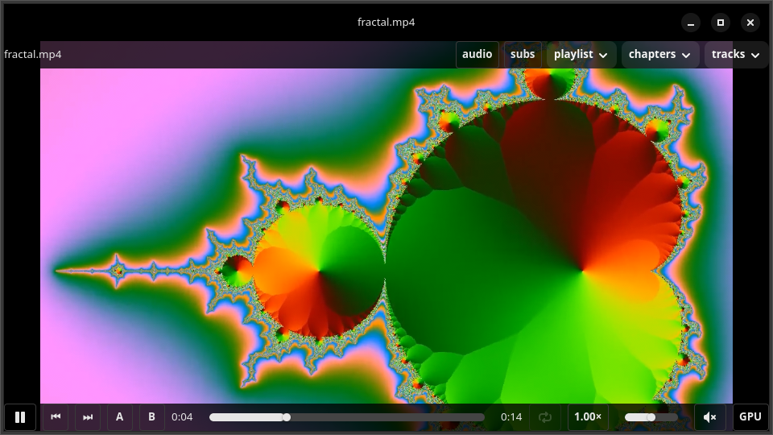
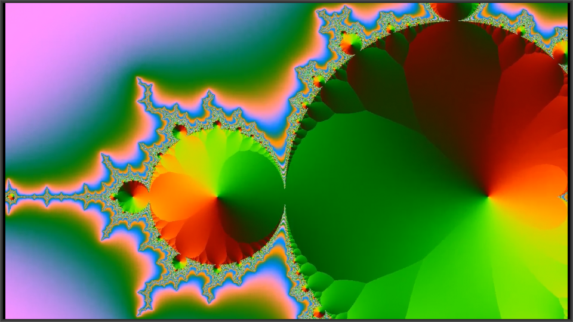
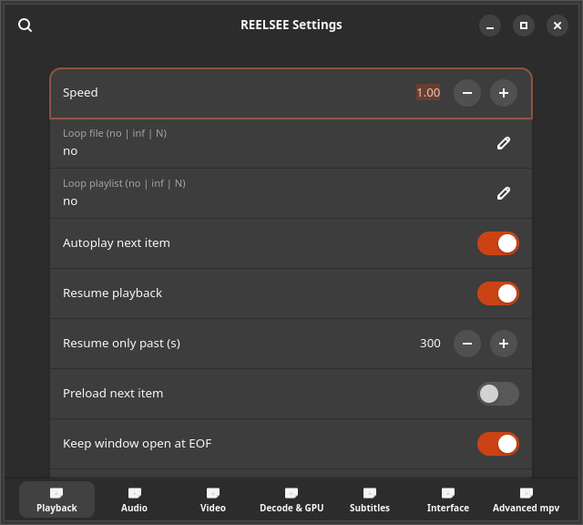

# REELSEE

A greenfield GTK 4 / libadwaita video player built directly on **libmpv
0.41** (client API) — no mpv binary, no subprocesses, no scripts. The video
is rendered by an in-process OpenGL pipeline: libmpv draws frames into an
FBO owned by a `GtkGLArea`, so decoding, GPU selection and every mpv option
are first-class citizens of one small Python application.


## What it looks like

| | |
|---|---|
|  | **Chrome revealed.** Title bar, menu strip, and the transport bar: play/pause, prev/next, `A`/`B` repeat points, position, seek, duration, repeat, speed, volume, mute — plus the live **GPU/CPU decode badge** at the right end. |
|  | **Chrome retracted.** A few seconds of pointer idle and every control — title bar included — fades out and the video owns the window. Move the mouse; it is back. Same idle behaviour as its sibling image viewer, Looksee. |
|  | **Settings.** Seven pages (Playback, Audio, Video, **Decode & GPU**, Subtitles, Interface, Advanced mpv). Everything is applied live; *Advanced mpv* exposes any remaining raw libmpv option, searchable and persisted. |

Images are generated from the app itself over the synthetic clips in
`testdata/`, headless under Xvfb:
`xvfb-run -a /usr/bin/python3 scripts/make_screenshots.py`. (The right-click
menu has no screenshot on purpose — GTK dismisses popups on focus-out and
Xvfb has no compositor, so a capture of it is not reproducible here.)


```
/usr/bin/python3 src/reelsee.py <file|folder|URL> [...]
```

From a checkout, libmpv is resolved automatically: `REELSEE_LIBMPV`,
a `vendor/` dir next to `src/reelsee.py`, the repo's
`vendor/usr/lib/x86_64-linux-gnu/libmpv.so.2`, then the **system**
`libmpv2`. For vendored-library runs put its dependencies on the loader
path (the app warns otherwise — a system libmpv2 needs none of this):

```
LD_LIBRARY_PATH=vendor/usr/lib/x86_64-linux-gnu /usr/bin/python3 src/reelsee.py video.mp4
```

---

## Feature matrix

**T1 — first-class UI control.** Every row below ships in the app; the
bracketed column tells where it lives.

| Area | What you get | Where |
|---|---|---|
| Transport | play / pause / stop / quit | space bar, ⏹ button, Ctrl+S / Ctrl+Q |
| Seek | ±5 s / ±30 s / percent (`seek … absolute`), exact frame stepping | ← → / Shift+← → / `,` `.` |
| Speed | 0.1–4.0, pitch-preserving (`audio-pitch-correction`) | `{`/`}` (Shift+`,`/`.`), settings slider, OSD presets |
| Loop | loop-file (no → inf → N) and loop-playlist | `l`, `r`, ⟳ chrome button |
| A/B | A/B section repeat + loop count (`ab-loop-count`), persisted per path | `[`, `]`, Shift+B / Backspace |
| Chapters | chapter list popover + next/prev + OSD on change | chapters menu, Page_Up / Page_Dn |
| Audio | track select (popover), external audio file, delay, device, exclusive mode | tracks menu, `a`, settings → Audio |
| Volume / mute | 0–130, persisted; per-window focus mute | ↑ ↓ / `m`, slider |
| Video track | select / audio-only mode (`vid=no`) | tracks menu, settings → Playback |
| Subtitles | track select, external `.srt/.ass…` file, delay, scale, visibility, styling preset (font / size / color / border / margin) | tracks menu, `v`, `t`, settings → Subtitles |
| Geometry | aspect override, zoom, pan-x/y, rotate, crop | settings → Video |
| Equalizer | brightness / contrast / saturation / gamma / hue | settings → Video |
| Quality | scale presets (default/fast/high/higher → `scale/cscale/dscale`), deband, dither depth, interpolation, tscale | settings → Video |
| Deinterlace | auto / yes / no | settings → Video |
| Screenshots | png/jpg + directory + quality; optional clipboard copy | `s`, settings → Interface |
| Window | fullscreen (F11), leave-Fullscreen (Esc), always-on-top, custom title format (`${media-title}` / `${filename}`) | `f`, Esc, settings → Interface |
| Resume | resume position per file in **our** `resume.json` (never mpv's `--resume-playback`) | automatic (`playback.resume`, `resume_min_s`) |
| Decode | hardware decode + GPU pin + CPU decode + overload watchdog (auto drop to `hwdec=no`) | settings → Advanced; auto round-robin across GPUs |
| Playlist | add file/folder, remove, reorder, shuffle, save/load `.m3u`, next/prev, natural sort, folder live-refresh | playlist menu, `n` / `b` |
| URLs | network playback, yt-dlp expansion when `yt-dlp` is on `PATH` (falls back to the raw URL) | just pass a URL |
| Audio-only / cover art | `vid=no`, `cover-art-auto` | settings → Playback |
| OSD | transient OSD on keyboard seek, track change, chapter change (mpv `osd-level=0`) | automatic |

**T2 — reachable live via settings → *Advanced* (raw mpv options panel).**
Everything else libmpv accepts: filters (`vf`/`af`), demuxer tunables, cache
behaviour, `save-position-on-quit`, etc. Searchable, applied live, persisted
under `mpv.options` in `config.json`.

**T3 — out of scope, deliberately:**

| Feature | Engine hook | Tier |
|---|---|---|
| Lua/JS scripting, `load-script`, `--script-opts` | — | refused (see blocklist) |
| VapourSynth (`--vf=vapoursynth`) | — | T3 (needs the runtime; not installed) |
| DVD/BluRay/DVB navigation UI | — | T3 |
| `--wid` embedding, macOS/Windows backends, `tct`/terminal output | — | T3 |
| Encoding / transcoding | mpv has none | T3 |

The R12 blocklist (`--script`, `--input-conf`, `load-script`,
`script-message`, …) is enforced at the CLI-parsing boundary: such tokens in
per-file options are refused, never forwarded to libmpv. Scripts are exactly
how the "mpv ate my machine" incidents happened; REELSEE does not accept
them from any input channel.

## Key bindings

Fully overridable in `~/.config/reelsee/input.conf` using mpv
`input.conf` syntax (`KEY action`); unknown actions are passed through as raw
mpv commands. Canonical source: `src/keymap.py`.

| Key | Action |
|---|---|
| `Space` / `p` | play / pause |
| `←` / `→` | seek ∓5 s |
| `Shift+←` / `Shift+→` | seek ∓30 s |
| `,` / `.` | frame back-step / step |
| `[` / `]` | set A / B repeat point |
| `Shift+B`, `Backspace` | clear A/B |
| `↑` / `↓`, `0` / `9` | volume ±5 |
| `m` | mute (transient while typing in a text field) |
| `f`, `F11` | fullscreen; `Esc` / `\` leave |
| `s` | screenshot |
| `a` | cycle audio track |
| `v` | cycle subtitle track; `t` toggles subtitle visibility |
| `l` | cycle loop-file (no → inf → N) |
| `r` | cycle loop-playlist |
| `{` / `}` | speed down / up (0.1–4.0) |
| `n` / `b` | playlist next / previous |
| `Page_Up` / `Page_Dn` (`Prior`/`Next`) | chapter previous / next |
| `Ctrl+S` | stop |
| `Ctrl+Q` | quit |
| `Ctrl+,` | settings |
| `q` | close window |

*Note:* single-character Gdk events canonicalise to uppercase (`m` → `"M"`),
so plain and Shift+letter are indistinguishable; shift-combos therefore only
exist for non-character keys (`Shift+←`, `Shift+B` clear-AB, `Shift+{`).

## Configuration & data files

| Path | Purpose |
|---|---|
| `~/.config/reelsee/config.json` | settings (atomic, 250 ms debounced writes, unknown keys preserved, corrupt file → defaults, never a crash) |
| `~/.config/reelsee/input.conf` | optional keymap overrides (mpv syntax) |
| `~/.local/state/reelsee/resume.json` | resume positions (cap 500, LRU) |
| `~/.local/state/reelsee/ab.json` | A/B repeat points per path (cap 500) |
| `~/.local/state/reelsee/engines.json` | last-good engine per GPU (pin memory) |

Test/dev hooks: `REELSEE_CONFIG_DIR`, `REELSEE_STATE_DIR`, `REELSEE_HEADLESS`,
`REELSEE_FAKE_LATENCY_MS` (IO latency injection, `reelsee_io` only),
`REELSEE_YTDLP_BIN` (override the yt-dlp binary; default `yt-dlp`),
`REELSEE_MPV_CLI` (only used to *enumerate* vulkan for diagnostics — the
player itself never spawns mpv).

## GPU / decode model

* Enumeration (Appendix B): glvnd EGL vendor ICD JSONs + sysfs DRM scan give
  every GPU with its PCI bus id; `--gpu-sw` style fallback included. Vulkan
  enumeration augments this only when `REELSEE_MPV_CLI` points at a real mpv
  binary — the default install needs no mpv.
* `engine.decoder = auto` round-robins new windows across distinct GPUs
  (the display-attached one first) so two windows get two different
  pipelines; failures are remembered in `engines.json` and pinned per GPU.
* Hardware decode tries in order (`nvdec-copy → hwflash-copy → vaapi-copy →
  vdpau-copy → …` for dGPU, `vaapi → vdpau` for iGPU); copy-back keeps the
  software scaler in control so the vendored libmpv ABI stays happy.
* Overload watchdog (Appendix C): a 5 s window of dropped-frame deltas that
  cross the configured floor/ceiling (and outpace the 10 ms render tick)
  drops `hwdec` to `no` with an OSD toast — once per file, with cooldown.
* Settings → Advanced lets you pin any engine/hwdec combo; the UI marks each
  engine *available / blocked (missing runtime) / pinned*.

## Troubleshooting

* **Black window, audio fine** — force `gpu-api=opengl` (the default;
  `gpu-next` segfaults against this libmpv build, see `scripts/spike_render.py`).
* **`libmpv.so.2` not found** — the app now exits 2 with a dialog naming
  the problem and remedy, and lists every searched path on stderr. The
  `.deb` relies on the **system** `libmpv2` (`sudo apt install libmpv2`);
  it ships no vendored copy. Point at an explicit file with
  `export REELSEE_LIBMPV=/path/to/libmpv.so.2` (checked first); the dev
  tree's `vendor/` dir is picked automatically when present.
* **VAAPI init fails / green frames** — settings → Advanced → decoder pin
  `cpu`, or let the watchdog do it; check `vainfo` output for supported
  profiles (the watchdog toast names the engine it dropped).
* **No subtitles** — `t` re-enables visibility; check Subtitles → font
  (`sans-serif` default) and `sub-ass-override`.
* **Playlist weird** — it is mpv's playlist; folder loads use natural sort
  and the folder monitor appends new files live (250 ms debounce).
* **High CPU on HiDPI laptop** — settings → Video → scale preset `default`
  (ewa_lanczos presets are expensive under software GL).

## Build & install

```
packaging/build-deb.sh            # → buildout/reelsee_0.1.0_all.deb
sudo apt install buildout/reelsee_0.1.0_all.deb
```

The package installs `/usr/bin/reelsee` (a shell wrapper), the Python
modules under `/usr/share/reelsee/`, the `.desktop` file
(`pro.krisforbes.Reelsee`, `X-Reelsee-Version=1`), the SVG icon and the
MIT copyright. Depends: `python3 (>= 3.10), python3-gi, gir1.2-gtk-4.0,
gir1.2-adw-1, libadwaita-1-0, libmpv2`.

**The deb relies on the system `libmpv2`** (Depends: above) and ships no
`vendor/` dir by design; a vendored build is only the one built with a
`vendor/` tree next to `/usr/share/reelsee/` (candidate 2 in the resolver),
and only then is `LD_LIBRARY_PATH` relevant to packaged runs. The package
gate proves the extracted tree launches and renders on a clean
environment (`env -u LD_LIBRARY_PATH -u REELSEE_LIBMPV`, fresh HOME/XDG) —
including paths with spaces and shell-hostile characters — and a negative
control proves the gate fails when no libmpv exists anywhere.

## Development

```
/usr/bin/python3 -m unittest discover tests          # pure unit suite (no display)
scripts/headless-smoke.sh <name> -- /usr/bin/python3 scripts/smoke_<x>.py
```

Every GUI/libmpv process goes through `scripts/headless-smoke.sh` (Xvfb +
software GL + vendored `LD_LIBRARY_PATH` + `hwdec=no`); smokes print
machine-checkable `SMOKE_CHECK:<name>=<value>` lines and exit non-zero on
failure. The smoke set: render, mpv_roundtrip, close, settings, chrome, ab,
engine, watchdog, multiwindow, slowio, package (extracted-tree launch +
negative control), libmpv_error (friendly-failure dialog really paints),
install_paths (installed layout vs spaces/apostrophe/`$&` paths built by the gate
itself), **t1** (playlist, popovers,
eq/geometry, clipboard, URL fallback), **resume** (two-process disk
roundtrip).

## Testing

```
/usr/bin/python3 -m unittest discover tests
```

292 tests, no display required (3 skip when their optional dependency is
absent). Behaviour that only exists with a real player is covered by the
headless smokes and the acceptance battery described in
[ARCHITECTURE.md](ARCHITECTURE.md) — gates carry negative controls so they
cannot pass by doing nothing.

## Status and roadmap

This snapshot is the feature set described above, verified as shipped.
In flight on top of it, in order:

* aspect-ratio-locked window resize (works for landscape *and* portrait
  sources; GTK4 has no geometry hints, so it is done from
  `Gdk.Surface::layout`)
* window geometry memory — a new window opens at the last window's size and
  position with a ±50 px cascade offset
* a fix for the repeat mode not surviving a reload of the same file
* **crop to window** — fill the window and hide the overflow, so a landscape
  video in a portrait window loses its sides instead of getting bars

Design rationale, requirement ids and the appendix proofs:
[docs/DESIGN.md](docs/DESIGN.md). Agent/contributor constraints:
[AGENTS.md](AGENTS.md), [CONTRIBUTING.md](CONTRIBUTING.md).
